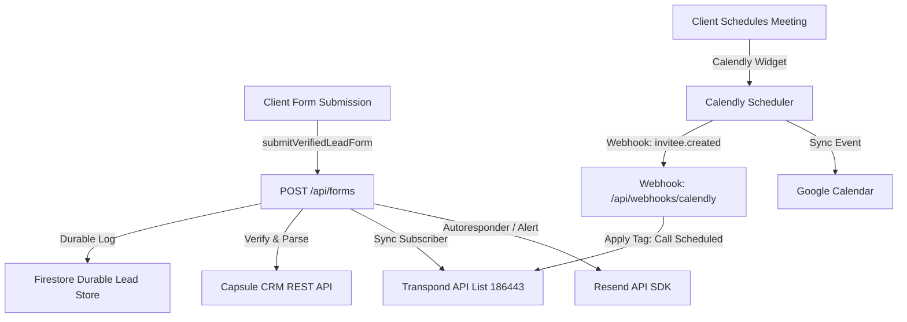

# 🌌 Power Digital Media — System Context & Source of Truth

> [!IMPORTANT]
> ### 🔔 MANDATORY DIRECTIVE FOR ALL DEVELOPER AGENTS
> **ALL FUTURE AI ASSISTANTS AND CONVERSATIONS MUST ADHERE TO THIS PROTOCOL:**
> 1. You **MUST** update this `context.md` file immediately upon completing any modification or milestone of importance (e.g., refactoring components, modifying CSS/Tailwind design systems, altering API/routing logic, updating CRM/Transpond sync engines, or resolving domain/account blocking bugs).
> 2. You **MUST** ensure that all sections (Technical Stack, System Architecture, Domain/SEO Alignments, Mobile UX framework, and Active Roadblocks) remain 100% accurate and mathematically/syntactically synced with the live codebase.
> 3. Never let this document fall out of date. It is the primary single source of truth for the Power Digital Media workspace.

---

## 🛠️ 1. Core Technical Stack
* **Framework:** Next.js 16.1.x (App Router) running on **Turbopack** and hosted on **Netlify**.
* **Design System ("Industrial Luxury"):** Architectural obsidian (`#06080f`), molten amber/copper (`#f59e0b`), blueprint grid depth (`.blueprint-grid`), `.obsidian-surface` panels, and high-contrast typography engineered for contractor & local business conversion.
* **Database, Lead Persistence & Integrations:**
  * **Durable Lead Delivery (`src/lib/durable-lead-delivery.ts` + `src/lib/firebase-admin.ts`):** Firestore durable persistence + retry outbox guaranteeing zero lost leads even during external API hiccups.
  * **Capsule CRM:** B2B lead organization & customer relationships (Damein is a certified Capsule Solutions Partner).
  * **Transpond:** Marketing automation campaigns and autoresponders (Main List ID: `186443`, Damein is a certified Transpond Solutions Partner).
  * **Resend SDK:** Transactional notification & fallback email delivery.
* **Proprietary Software & Watchtower Showcases:**
  * **`PinCam™` (`/pincam`):** Interactive 5-mode contractor camera & proof studio (Ghost Camera Photo Match 0–90% opacity overlay, non-destructive vector markups/measurements, dual-camera PiP walkthroughs, instant homeowner/adjuster PDF reports, and 1-tap `PinDrop™` sync).
  * **`PinDrop™` (`/pindrop`):** Interactive 5-stage field-to-Google SEO engine (30s mobile check-in, auto-published `/projects/[slug]` & `/areas-we-service/[city]` geo-schema pages, live Central MS map pins, Google Business Profile OAuth sync, and 15-min SMS 5-star review automation).
  * **`PDM Site Intelligence™` (`/site-intelligence`):** Authentic 4-phase interactive Watchtower console (`#070b14` + cyan/emerald/amber telemetry modeled on `pdm-site-intelligence`) showcasing 5-minute multi-probe HTTP/SSL checks, Google Search Console & GA4 `7d/28d/90d` growth deltas, CrUX cellular Core Web Vitals + Rich Result schema validation, and the 2-Stage Human Approval AI remediation queue. Positioned under `Services ▾` so `Field Apps ▾` stays 100% dedicated to field crews.
* **Booking Pipeline:** Calendly scheduling widget integrated dynamically at `/book` + modal triggers.

---

## 🔗 2. System Architecture & Integrations

### 🗄️ Form Security & Lead Normalization
1. **Bot-Hardened Client Submissions (`src/lib/lead-submission.ts` & `src/components/ui/FormSecurityFields.tsx`):**
   - Injects honeypot + timing verification fields across `AuditCTA.tsx`, `/free-audit`, `Contact.tsx`, and `/contact`.
2. **Zero-Friction Mobile URL/Business Normalization:**
   - Replaced strict HTML5 `type="url"` inputs (which silently blocked bare domains like `bornagainroofing.com` on iOS/Android keyboards) with smart `type="text"` normalization (`normalizeWebsiteOrBusiness`) plus `Name`, `Cell Phone`, and `Trade / Industry` capture.

---

## 🌐 3. Critical SEO, Money Pages & Domain Alignments
* **Active Domain:** `https://powerdigitalmedia.org`
* **Active Phone / SMS Line:** `+16014462393` / `(601) 446-2393` (NAP verified across all metadata, schemas, and UI).
* **Global Structured Data (`src/app/layout.tsx`):**
  * `@graph` combining `LocalBusiness` + `ProfessionalService`, `AggregateRating` (`5.0` across `15` verified reviews), and `SoftwareApplication` offers for `PinCam™` and `PinDrop™`.
  * Corrected `<meta name="apple-mobile-web-app-title">` to `"Power Digital Media"`.
* **High-Intent Vertical & Service Money Pages:**
  * `/contractors` — Flagship Mississippi Contractor Growth Systems page (Roofing, HVAC, Excavation/Dirt Work, Plumbing, Electrical, Lawn Care) with `Service` + `FAQPage` JSON-LD.
  * `/local-seo` — Google Map Pack & Local SEO engineering page (with permanent `301` redirect from `/seo` and `/google-maps` in `next.config.mjs`).
  * `/web-design` — Pure Server Component (removed unnecessary `"use client"` wrapper) with `Service` + `FAQPage` JSON-LD.
  * `/site-intelligence` — Authentic 4-phase Watchtower showcase (`SoftwareApplication` + `FAQPage` JSON-LD) cross-linked across `Services ▾`, `Footer`, `/web-design`, `/local-seo`, and `/free-audit` (with `301` redirects from `/watchtower` and `/site-monitoring`).
  * `/pincam` & `/pindrop` — Twin proprietary app showcases faithfully modeling the **actual production UI** of `PDM PinDrop™` (`#0b0c10` / `#12141c` double-bezel obsidian, real Central MS Esri World Imagery satellite map + gold teardrop pins, 2-column `.pin-feed-card` cards with neighborhood satellite mini-maps, interactive `/admin/drop-pin` crew portal, `/pin-page` Answer Engine SEO detail view, and 1-line `<iframe>` embed snippet) and `PinCam™` (native Android APK + iPhone Home Screen dashboard, Ghost Photo Match, non-destructive markup, Dual-Cam PiP, PDF report, and 5-tab mobile dock). Featured inside the signature `Field Apps` dropdown in `Navbar.tsx` and `JobsitePipelineStory.tsx`, with zero legacy stock/fake `.webp` mockups.
* **Central Mississippi 6-City Static Hubs (`src/data/locations.ts` + `src/app/locations/[city]/page.tsx`):**
  * `/locations/jackson-ms`, `/locations/madison-ms`, `/locations/ridgeland-ms`, `/locations/brandon-ms`, `/locations/flowood-ms`, `/locations/clinton-ms` — each with unique county/ZIP coordinates, corridors, subdivisions, live local client proof, and `Service` + `FAQPage` + `BreadcrumbList` JSON-LD.
* **Crawler, Schema & AI Discovery:**
  * Resolved static `public/robots.txt` vs `src/app/robots.ts` HTTP `500` conflict and added explicit allow rules for `GPTBot`, `OAI-SearchBot`, `ChatGPT-User`, `ClaudeBot`, `PerplexityBot`, `Google-Extended`, and `Applebot-Extended`.
  * Added `SpeakableSpecification` on `/`, automatic `FAQPage` JSON-LD in `FAQAccordion.tsx`, `Review` JSON-LD on `/reviews`, and updated `src/app/sitemap.ts`, `public/manifest.json`, `public/llms.txt`, and `public/llms-full.txt`.
* **100% Case-by-Case Custom Scoping & Public Payment Policy:**
  * Public self-checkout and pricing pages (`/billing`, `/billing/bespoke`, `/pay/*`) are retired and permanently `301`-redirected in `next.config.mjs` (`/billing*` & `/pricing` → `/book`; `/pay*` → `/contact`), while internal portal billing (`/dashboard/billing`), `/admin/*`, and `/api/*` remain active for existing clients.
  * Zero public agency, monthly retainer, or standalone app dollar prices appear in UI copy, FAQs, discovery forms, JSON-LD schemas, or `llms*.txt`; every engagement is custom-scoped case-by-case via `/free-audit` or `/book`.

---

## 📱 4. Mobile Conversion & UX Architecture
* **Unobstructed `16:10` Mobile Viewport & Anti-Squeeze Card Architecture (Verified Across All 24 Public Routes @ `390×844` & `360×800`):**
  * **Zero Text Floating Over Previews or Photos:** Every client website screenshot, satellite map, field-app viewfinder, and founder studio portrait renders in its full, uncropped `aspect-[16/10]` (or `aspect-[4/3]` blog art) aspect ratio with **zero** floating caption cards, dark gradient overlays, or overlapping badges covering the image. All telemetry, GPS stamps, client headlines, speed badges, and founder captions (`LeadArchitect.tsx`, `AboutClient.tsx`, `ContractorHeroStage.tsx`, `ConnectedArchitecture.tsx`, `JobsitePipelineStory.tsx`, `PinDropDemoExplorer.tsx`, `PinCamInteractiveStage.tsx`, `contractors/page.tsx`) dock cleanly below the media frame.
  * **Isolated `/portfolio/[id]` Showcase (`ProjectShowcaseClient.tsx`):** `"interactive"` mode renders only the opaque live `<iframe>` (`h-[540px] sm:h-[620px] md:h-[700px]`), while `"screenshot"` mode renders an uncropped `aspect-[16/10]` HD snapshot—eliminating horizontal image cropping and iframe double-exposure bleed.
  * **Inner Browser Frame Geometry (`Portfolio.tsx` & `/our-work`):** `aspect-[16/10]` is applied directly to the inner image container below the `33px` browser top bar so previews never lose vertical aspect ratio, paired with stacked full-width mobile CTAs (`grid-cols-1 sm:grid-cols-2` / `flex-col sm:flex-row`).
  * **De-Squeezed Mobile Margins & App Stages:** Eliminated double/triple nested card padding (`p-4 sm:p-8` / `p-5 sm:p-9` across forms and interactive stages, recovering `+48px`–`+64px` of usable input/stage width on `360px`–`390px` phones), stacked `.pin-feed-card` satellite/photo grids (`grid-cols-1 sm:grid-cols-2`), and added `break-all` + `flex-wrap` guards so zero routes experience horizontal overflow (`scrollWidth === clientWidth`).
* **Thumb-Zone `StickyMobileDock.tsx`:** Persistent mobile-only (`lg:hidden`) bottom dock featuring 1-tap `Call`, `Text`, and `Free Check` actions with `env(safe-area-inset-bottom)` clearance, automatically hidden on admin/auth routes and whenever mobile keyboard inputs are focused.
* **Interactive Homepage Stages (`src/components/sections/ContractorHeroStage.tsx` & `JobsitePipelineStory.tsx`):**
  * 4-trade interactive hero console (*Roofing & Storm*, *Excavation & Civil*, *HVAC & Trades*, *Local Commerce*) with full `16:10` client screenshots and non-overlapping telemetry dock below.
  * 3-step interactive field-to-phone story (`01 PinCam™ Capture` → `02 PinDrop™ Map & Auto-SEO` → `03 18-Second SMS Lead Rescue`).
* **Unified Lead Magnet Offer:** Standardized sitewide around the **"Free 5-Minute Google Rank & Website Breakdown"** recorded personally by Damein Donald, replacing abrupt 1-second redirects with an interactive confirmation state + optional 1-click booking.

---

## 🚨 5. External Operational Follow-Ups (Owner Actions)
1. **Permanent Google Business Profile (GBP) API Sync (`src/data/gbp-profile.ts` & `scripts/gbp-sync.ts`):**
   * **Live GBP Manual Optimization 100% Complete (`Power Digital Media LLC` — Store Code `16859162098440684472`):** Verified Home-Office Service-Area Business (`CUSTOMER_LOCATION_ONLY`) updated 1:1 with website: 5 categories, 13 service items with descriptions, 11 Tri-County service areas, Ultatel-free description, `https://powerdigitalmedia.org/` website + `/book` booking link, `Mon–Fri 9:00 AM–5:00 PM CT` hours, `Online appointments` enabled, `16:9` Cover Photo, 4 `4:3` Product Cards (`Contractor Growth Websites`, `PDM PinDrop`, `PinCam`, `PDM Site Intelligence`), and fresh Google Update post.
   * **GBP API Allowlist Case Submitted:** Google Support Case ID **`6-2776000041917`** (submitted for GCP Project `power-digital-media` / Project Number `978634389841`; removed stale suspended Flora duplicate so manager account is `100% verified` across `Power Digital Media LLC` and `Born Again Home Remodeling & Roofing, LLC`).
   * Once Google's approval email arrives (~7–10 business days), run `npm run gbp:auth` and `npm run gbp:audit` / `npm run gbp:push -- --apply`.
2. **Standalone `pindrop-saas` App Polish (Next Engineering Track):** Debug & finalize remaining production workflows inside `e:\AntiGravity\pindrop-saas` (`PinCamNativeApp.tsx` / `PinDrop` SaaS backend) following deployment of `powerdigitalmedia.org`.
